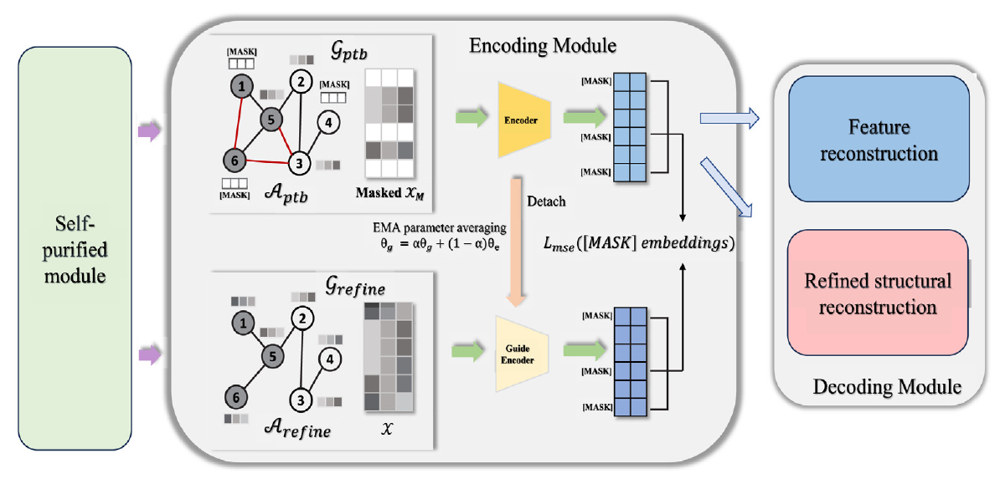
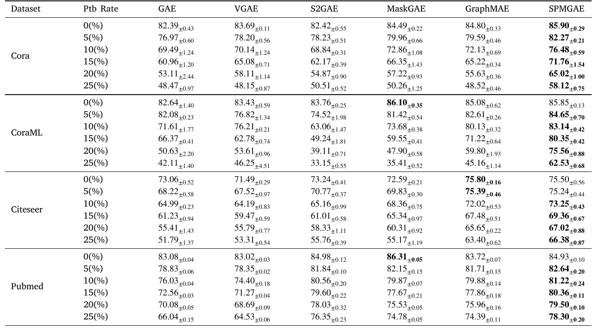
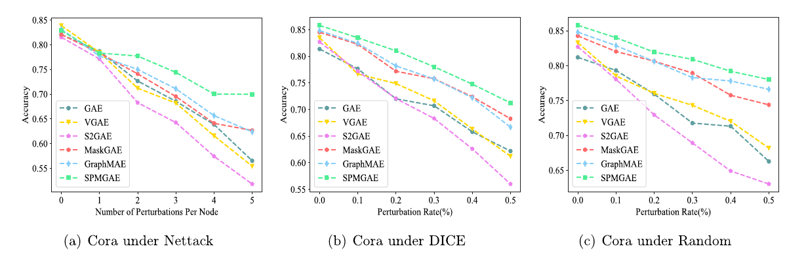
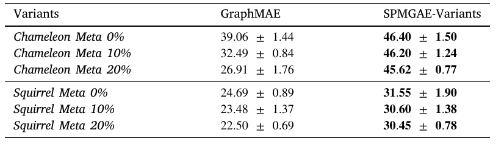

<h1 align="center">
  
</h1>

<p align="center">
  <strong>Shuhan Song</strong> · <strong>Ping Li</strong> · <strong>Ming Dun</strong> · <strong>Yuan Zhang</strong> · <strong>Huawei Cao</strong><sup>*</sup> · <strong>Xiaochun Ye</strong>
  <br>
  <a href="https://doi.org/10.1016/j.neucom.2024.128631"></a>
  <a href="https://www.sciencedirect.com/science/article/pii/S0925231224014024"></a>
  <br>
  <a href="https://www.python.org/"></a>
  <a href="https://pytorch.org/"></a>
  <a href="https://www.dgl.ai/"></a>
  <a href="https://ogb.stanford.edu/"></a>
  <br>
  <a href="https://doi.org/10.1016/j.neucom.2024.128631"><strong>📄 Paper</strong></a> ·
  <a href="#method"><strong>🧠 Method</strong></a> ·
  <a href="#experiments"><strong>📊 Experiments</strong></a> ·
  <a href="#quick-start"><strong>🚀 Quick start</strong></a> ·
  <a href="#citation"><strong>📚 BibTeX</strong></a>
</p>

---

<a name="overview"></a>

## 🧭 Overview

Masked graph autoencoders learn node representations by reconstructing masked inputs. When a graph contains noisy edges or connects nodes with dissimilar labels and features, reconstruction can reinforce those unreliable signals. **SPMGAE** addresses this during self-supervised pre-training by refining the graph, learning from both refined and perturbed views, and reconstructing node features together with refined structure.

This repository accompanies the journal article published in **Neurocomputing**, volume **611**, article **128631**, in **2025**. [Publisher version](https://doi.org/10.1016/j.neucom.2024.128631)

<a name="method"></a>

## 🧠 Method

<p align="center">
  <a href="./docs/spmgae/figure-03-framework.png"></a>
  <br>
  <em>Figure 3 from the paper · SPMGAE architecture.</em>
</p>

| Stage | What it does |
| --- | --- |
| **Self-purification** | Uses feature similarity to separate potentially unreliable edges and build a refined graph. A subset of the removed edges supplies a perturbed view for auxiliary training. |
| **Mirror-guided encoding** | A guide encoder updated by exponential moving average sees the refined view. The main encoder learns to align its masked-node embeddings with the guide's representations. |
| **Dual reconstruction** | A feature decoder reconstructs masked attributes, while a structure decoder learns from the refined graph. The pre-trained encoder supplies embeddings for downstream node classification. |

<a name="experiments"></a>

## 📊 Experiments

### Node classification under structural perturbations

At the **25%** Metattack evaluation point on **Cora-ML**, SPMGAE reaches **62.53%** accuracy, **16.28 percentage points** above the strongest baseline in that row (VGAE, 46.25%).

[](./docs/spmgae/table-05-main-results.png)

### Robustness across benchmarks

Figure 7 compares node classification on Cora across three additional perturbation benchmarks. The paper also evaluates the method on ogbn-arxiv with mini-batch training.

[](./docs/spmgae/figure-07-robustness.png)

### Heterophilic graphs

On Chameleon and Squirrel, the paper evaluates an SPMGAE variant with a **GPRGNN encoder** and a **GAT decoder**. Table 7 compares it with GraphMAE in the clean and perturbed settings.

[](./docs/spmgae/table-07-heterophily.png)

<a name="quick-start"></a>

## 🚀 Quick start

Use a Python environment with compatible [PyTorch](https://pytorch.org/get-started/locally/), [DGL](https://www.dgl.ai/pages/start.html), and [PyTorch Geometric](https://pytorch-geometric.readthedocs.io/en/stable/install/installation.html) installations. Install the remaining imports with:

```bash
python -m pip install numpy scipy scikit-learn ogb easydict pyyaml tqdm tensorboardX psutil
```

From the repository root, run full-batch pre-training and node classification on clean Cora:

```bash
python train.py --dataset Cora --attack no
```

Clean **Cora**, **Citeseer**, and **Pubmed** use the DGL dataset loader. [`configs.yml`](./configs.yml) contains per-dataset settings, and [`build_easydict.py`](./build_easydict.py) defines the defaults.

### Larger graphs and benchmark inputs

[`train_mini_batch.py`](./train_mini_batch.py) is the mini-batch entry point used for larger graphs. Check the dataset roots in [`datasets_dgl/`](./datasets_dgl) before using ogbn-arxiv or the perturbed benchmark inputs. The latter expect precomputed adjacency files, features, labels, and splits at the paths configured in the dataset loaders.

## 🗂️ Repository guide

| Path | Contents |
| --- | --- |
| [`train.py`](./train.py) and [`train_mini_batch.py`](./train_mini_batch.py) | Full-batch and mini-batch pre-training entry points. |
| [`models/`](./models) | Autoencoder, guide encoder, reconstruction, and GNN backbones. |
| [`datasets_dgl/`](./datasets_dgl) | Dataset loading and preprocessing. |
| [`evaluation.py`](./evaluation.py) and [`evaluation_mini_batch.py`](./evaluation_mini_batch.py) | Downstream node classification evaluation. |

<a name="citation"></a>

## 📚 Citation

```bibtex
@article{song2025spmgae,
  title   = {{SPMGAE}: Self-purified masked graph autoencoders release robust expression power},
  author  = {Shuhan Song and Ping Li and Ming Dun and Yuan Zhang and Huawei Cao and Xiaochun Ye},
  journal = {Neurocomputing},
  volume  = {611},
  pages   = {128631},
  year    = {2025},
  doi     = {10.1016/j.neucom.2024.128631}
}
```
